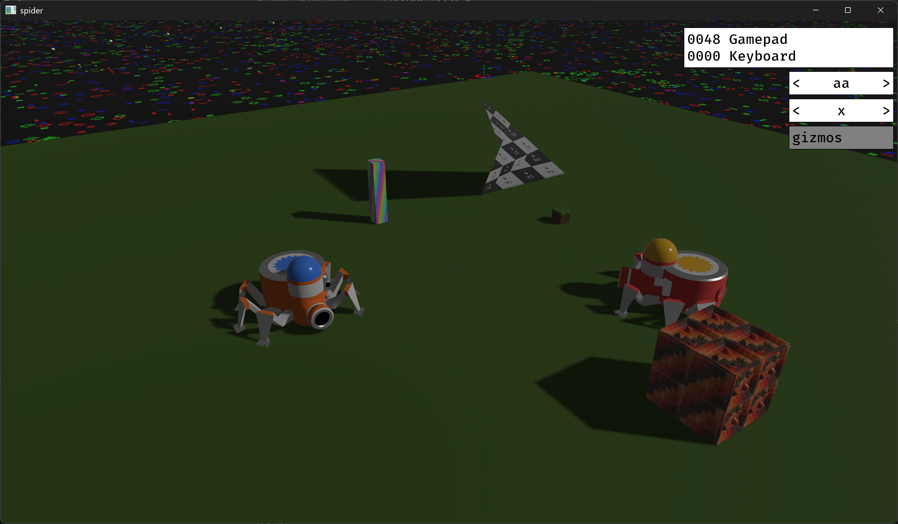

# Spider

* Install a >1.97.0 rust toolchain.
* Use `cargo run --release` to start the game.
* Use `cargo check --release --all-targets` to check everything is ok.
* Use `cargo test --release --all-targets` to run the tests.

## Optional features

* `debug_scene`: demo props and simulation plane.
* `debug_gizmos`: robot reference axes and leg markers.

## Obstacles

* Low walls block vehicles but allow bullets through.
* High walls block both vehicles and bullets.
* Bullet-wall collisions use the current bullet segment, not a sweep between frames.

## Keyboard controls

* Up/Down arrows: accelerate/brake.
* Left/Right arrows: turn.
* Page Up/Page Down: strafe left/right relative to the spider's heading.
* Left Ctrl: fire.

## Gamepad controls

* Right stick horizontal: turn.
* Left stick horizontal: strafe left/right relative to the spider's heading.
* Left stick up/down: accelerate/brake.
* R1 (right bumper): fire.

